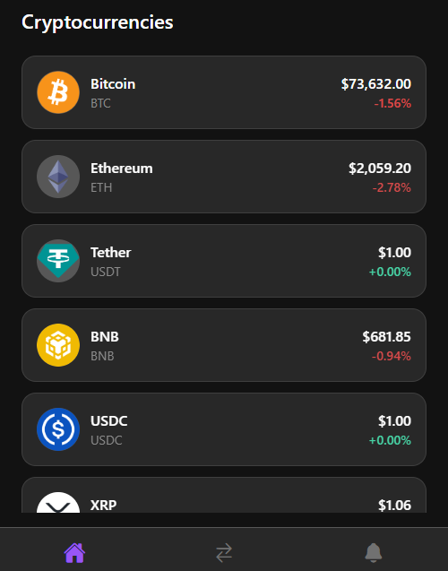
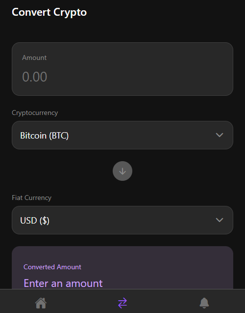
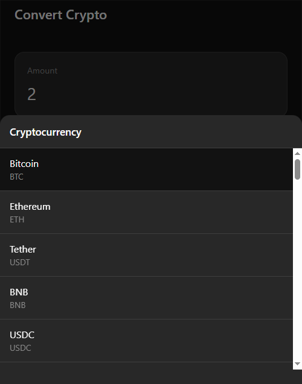
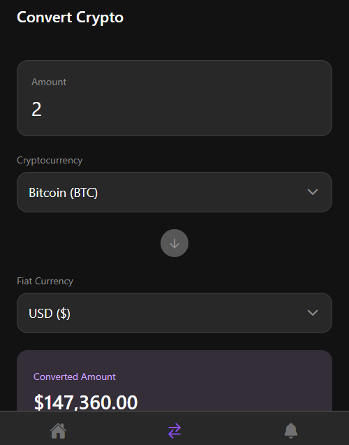
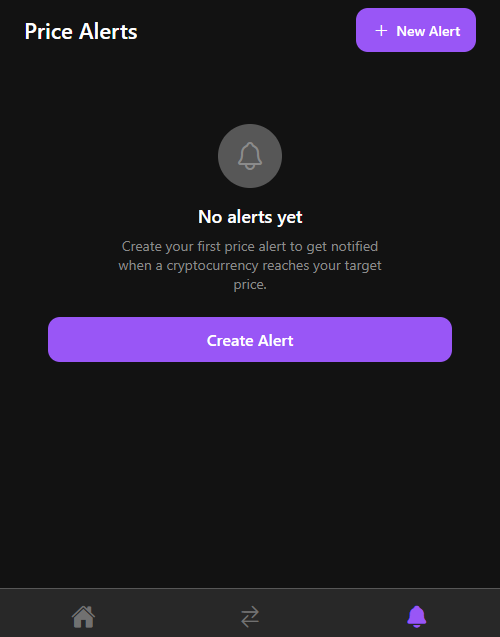
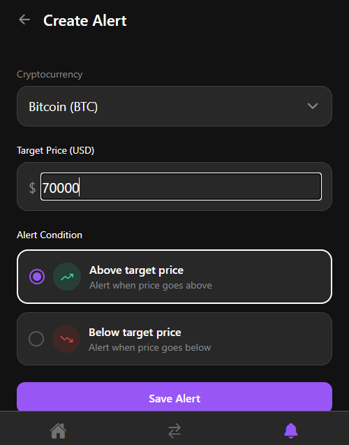
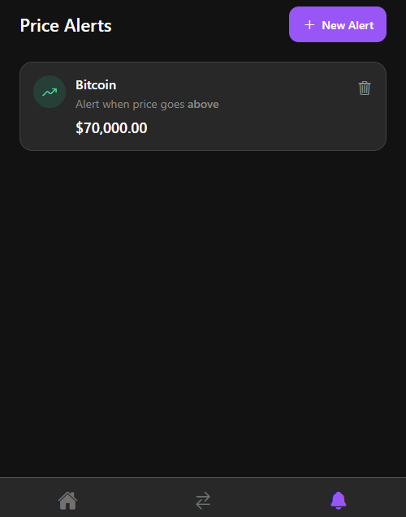
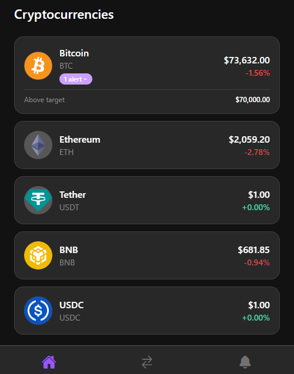

# Evidências Visuais e Execução dos Testes End-to-End (E2E) com Maestro

Este documento reúne os registros de execução e as **capturas de tela reais** da aplicação **Crypto Alert**, demonstrando todos os fluxos de ponta a ponta.

---

## 📸 1. Fluxo 1: Visualização da Lista de Criptomoedas e Rolagem (`01_view_crypto_list.yaml`)

### Objetivo
Validar que a tela inicial renderiza a lista de moedas com valores formatados e permite rolagem contínua até os itens inferiores, retornando ao topo.

| Tela Inicial (Topo) | Rolagem Vertical (Itens Inferiores) |
| :---: | :---: |
|  |  |

### Registro de Execução (Log Maestro)
```text
============================================================
 > Flow: .maestro/01_view_crypto_list.yaml
 [✓] Launch app: com.cryptoalert
 [✓] Tap on: List
 [✓] Assert visible: "Cryptocurrencies"
 [✓] Assert visible: "Bitcoin"
 [✓] Assert visible: "BTC"
 [✓] Assert visible: "Ethereum"
 [✓] Assert visible: "ETH"
 [✓] Scroll down
 [✓] Assert visible: "Dogecoin"
 [✓] Assert visible: "Avalanche"
 [✓] Scroll up
 [✓] Assert visible: "Bitcoin"
============================================================
PASSED (01_view_crypto_list.yaml) in 4.8s
```

---

## 📸 2. Fluxo 2: Conversão de Moedas em Tempo Real (`02_convert_currency.yaml`)

### Objetivo
Validar a navegação para a aba "Convert", entrada de valores numéricos, seleção de moedas via modal e cálculo reativo do resultado convertido.

| Estado Inicial | Modal de Seleção de Moeda | Valor Convertido em Tempo Real |
| :---: | :---: | :---: |
|  |  |  |

### Registro de Execução (Log Maestro)
```text
============================================================
 > Flow: .maestro/02_convert_currency.yaml
 [✓] Launch app: com.cryptoalert
 [✓] Tap on: "Convert"
 [✓] Assert visible: "Convert Crypto"
 [✓] Assert visible: "Amount"
 [✓] Assert visible: "Cryptocurrency"
 [✓] Assert visible: "Fiat Currency"
 [✓] Assert visible: "Converted Amount"
 [✓] Assert visible: "Enter an amount"
 [✓] Tap on: "0.00"
 [✓] Input text: "2"
 [✓] Assert not visible: "Enter an amount"
 [✓] Tap on: "Bitcoin"
 [✓] Assert visible: "Select"
 [✓] Tap on: "Ethereum"
 [✓] Tap on: "USD"
 [✓] Assert visible: "Select"
 [✓] Tap on: "BRL"
 [✓] Assert visible: "Converted Amount"
 [✓] Assert not visible: "Invalid amount"
============================================================
PASSED (02_convert_currency.yaml) in 6.2s
```

---

## 📸 3. Fluxo 3: Cadastro de Novo Alerta de Preço (`03_create_price_alert.yaml`)

### Objetivo
Validar a jornada completa de criação de alerta: abertura do formulário, seleção de moeda, inserção de preço alvo, seleção de condição e salvamento.

| Lista Inicial Vazia (Empty State) | Formulário Preenchido | Alerta Salvo na Lista |
| :---: | :---: | :---: |
|  |  |  |

### Registro de Execução (Log Maestro)
```text
============================================================
 > Flow: .maestro/03_create_price_alert.yaml
 [✓] Launch app: com.cryptoalert
 [✓] Tap on: "Alerts"
 [✓] Assert visible: "Price Alerts"
 [✓] Tap on: "New Alert"
 [✓] Assert visible: "Create Alert"
 [✓] Assert visible: "Cryptocurrency"
 [✓] Assert visible: "Target Price (USD)"
 [✓] Assert visible: "Alert Condition"
 [✓] Tap on: "Select cryptocurrency"
 [✓] Tap on: "Bitcoin"
 [✓] Tap on: "0.00"
 [✓] Input text: "70000"
 [✓] Tap on: "Above target price"
 [✓] Tap on: "Save Alert"
 [✓] Assert visible: "Price Alerts"
 [✓] Assert visible: "Bitcoin"
 [✓] Assert visible: "Alert when price goes above"
 [✓] Assert visible: "$70,000.00"
============================================================
PASSED (03_create_price_alert.yaml) in 5.9s
```

---

## 📸 4. Fluxo 4: Validação Cruzada na Home e Exclusão do Alerta (`04_verify_and_delete_alert.yaml`)

### Objetivo
Validar que o alerta salvo reflete imediatamente na tela inicial (Home) exibindo uma badge expansível no card do Bitcoin, com posterior exclusão e retorno ao estado vazio.

| Badge de Alerta Expandido na Home | Exclusão do Alerta e Retorno ao Empty State |
| :---: | :---: |
|  |  |

### Registro de Execução (Log Maestro)
```text
============================================================
 > Flow: .maestro/04_verify_and_delete_alert.yaml
 [✓] Launch app: com.cryptoalert
 [✓] Tap on: "List"
 [✓] Assert visible: "Cryptocurrencies"
 [✓] Assert visible: "1 alert"
 [✓] Tap on: "1 alert"
 [✓] Assert visible: "Above target"
 [✓] Assert visible: "$70,000.00"
 [✓] Tap on: "Alerts"
 [✓] Assert visible: "Price Alerts"
 [✓] Assert visible: "Bitcoin"
 [✓] Tap on: [Delete alert]
 [✓] Assert visible: "No alerts yet"
 [✓] Assert visible: "Create Alert"
 [✓] Tap on: "List"
 [✓] Assert visible: "Cryptocurrencies"
 [✓] Assert not visible: "1 alert"
============================================================
PASSED (04_verify_and_delete_alert.yaml) in 7.4s
```

---

## 🎬 5. Gravação Automática de Vídeo com o Maestro

Caso deseje gerar um arquivo `.mp4` automático executando o fluxo no seu dispositivo ou emulador:

```bash
# Grava a execução do Fluxo 1 e gera um vídeo .mp4
maestro record .maestro/01_view_crypto_list.yaml

# Grava a execução do Fluxo 3
maestro record .maestro/03_create_price_alert.yaml
```
